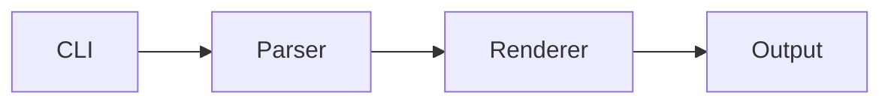

# Markdown patterns

GitHub-rendered patterns for READMEs. Use only where content calls for it — pattern exists ≠ pattern required.

## Themed logo (dark/light)

Header icon with separate dark/light assets. Only when both variants exist; single asset → plain ``.

```html
<p align="center">
  <picture>
    <source media="(prefers-color-scheme: dark)" srcset="assets/logo-dark.png">
    
  </picture>
</p>
```

## Admonitions

Load-bearing callouts only (version requirements, gotchas, destructive steps) — not routine description.

```markdown
> [!NOTE]
> Neutral, supplementary info.

> [!TIP]
> Optional but helpful suggestion.

> [!IMPORTANT]
> Something the reader must not miss.

> [!WARNING]
> Could cause a problem if ignored.

> [!CAUTION]
> Risk of a negative/destructive outcome.
```

## Collapsible sections

Optional/secondary content that would bloat main flow (alternate installs, manual uninstall, verbose FAQ). Recommended path stays outside. Blank line after `<summary>` and before `</details>` or inner markdown won't render.

```markdown
<details>
<summary>Section title</summary>

Content — full markdown works inside.

</details>
```

## Keyboard keys

Shortcuts and key combos in usage docs.

```markdown
Press <kbd>Ctrl</kbd> + <kbd>Shift</kbd> + <kbd>P</kbd> to open the command palette.
```

## Mermaid diagrams

"How it works" / architecture / request flow — when a diagram replaces a paragraph of prose. Keep ≤ ~10 nodes.

````markdown

````

## Diff blocks

Config/code changes the user must make ("add this to your config").

````markdown
```diff
  "scripts": {
-   "build": "tsc"
+   "build": "tsc && node scripts/copy-assets.js"
  }
```
````

## Tables

Options/flags/env vars — one row per option. Colons set column alignment.

```markdown
| Option    | Default | Description        |
|:----------|:-------:|:-------------------|
| `--watch` | `false` | Rebuild on change. |
```

## Footnotes

Side notes/citations that would break sentence flow.

```markdown
Works on Node 18+.[^1]

[^1]: Node 16 works with `--experimental-fetch`.
```

## Task list

Roadmap / planned features.

```markdown
- [x] Dark mode
- [ ] Plugin API
```

## Small caption

Caption under a screenshot or demo GIF.

```html
<p align="center">
  <br>
  <sub>Rendering a report from a sample config.</sub>
</p>
```

## Back to top

Long READMEs only (many sections, TOC present). GitHub auto-generates the heading outline menu, so skip manual TOC on short READMEs.

```markdown
<a name="top"></a>

...

<p align="right"><a href="#top">Back to top</a></p>
```
